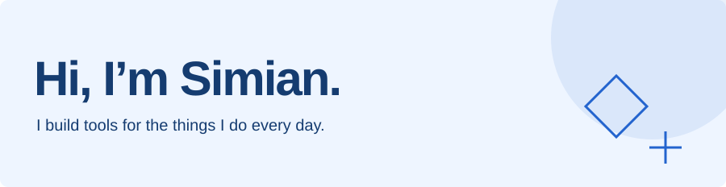

<picture>
  <source media="(prefers-color-scheme: dark)" srcset="assets/profile-dark.svg" />
  <source media="(prefers-color-scheme: light)" srcset="assets/profile-light.svg" />
  
</picture>

My projects usually start with something I wish existed: a better way to find saved pages, split a bill, or turn a receipt into useful data. I’m studying Computer Science at the University of Waterloo.

<a href="https://simianwang.me">Website</a> &nbsp; / &nbsp; <a href="https://www.linkedin.com/in/SiMianWang/">LinkedIn</a>

### Things I’m building

| Project | What it does |
| :--- | :--- |
| [DevRecall](https://github.com/SimianW/DevRecall) | Save technical pages and find them again with keyword and semantic search. |
| [Share Tally](https://github.com/SimianW/share-tally) | Split group expenses, confirm shares, and settle balances with fewer repayments. |
| [SnapLedger](https://github.com/SimianW/SnapLedger) | Extract receipt data, validate it, and organize expenses with AI. |

### Tools I work with

TypeScript · Python · React · Next.js · PostgreSQL · Linux

  <a href="https://github.com/SimianW">
    <picture>
      <source media="(prefers-color-scheme: dark)" srcset="https://streak-stats.demolab.com/?user=SimianW&hide_border=true&background=14243b&ring=79b4ff&fire=79b4ff&currStreakNum=e3efff&sideNums=e3efff&currStreakLabel=79b4ff&sideLabels=e3efff&dates=a4b6cd" />
      <source media="(prefers-color-scheme: light)" srcset="https://streak-stats.demolab.com/?user=SimianW&hide_border=true&background=eef5ff&ring=2364ce&fire=2364ce&currStreakNum=153c70&sideNums=153c70&currStreakLabel=2364ce&sideLabels=153c70&dates=637083" />
      
    </picture>
  </a>

